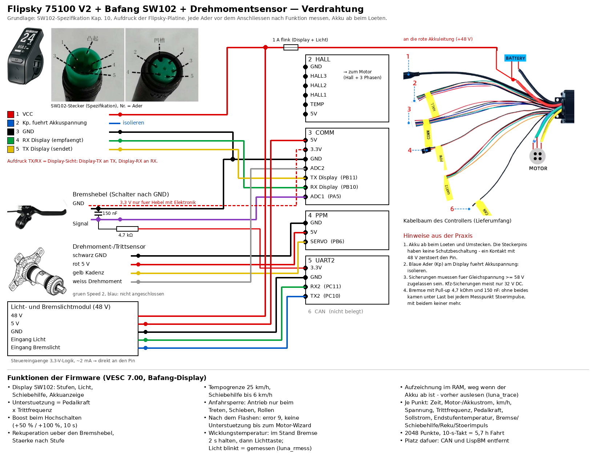

# VESC 7.00 für E-Bikes: Flipsky 75100 V2 + Bafang SW102 + Drehmomentsensor

Weiterentwicklung von **stancecokes VESC_BLDC** (Bafang-Display am Flipsky,
github.com/stancecoke/VESC_BLDC), portiert auf **VESC 7.00** von Benjamin
Vedder (`vedderb/bldc`), GPLv3. Erweitert für ein Pedelec mit Nabenmotor,
Drehmomentsensor und Bafang-Display SW102. Danke an stancecoke für die
Grundlage.

## Funktionen
- Display SW102: Unterstützungsstufen, Licht, Schiebehilfe, Akkuanzeige
- Unterstützung = Pedalkraft × Trittfrequenz, Boost beim Hochschalten
  (+50 % / +100 %, klingt in 10 s ab)
- Rekuperation über den Bremshebel, Stärke nach Stufe
- **Pedelec 25:** Unterstützung bis 25 km/h, Schiebehilfe bis 6 km/h,
  Akkustrom höchstens 10 A
- Anfahrsperre: Antrieb nur beim Treten, Schieben oder rollendem Rad
- Stufentabellen relativ zum eingestellten Motorstrom (Bezug 60 A)
- Wicklungstemperatur über den Widerstand (`luna_rmess`)
- Aufzeichnung im RAM, 2048 Punkte (`luna_trace`), 10-s-Takt = 5,7 h Fahrt.
  Weg, wenn der Akku ab ist. Dafür sind CAN und LispBM entfernt.

## Inbetriebnahme
1. Bauen: `make 75_100_V2` – oder die fertige `.bin` aus den Releases nehmen
2. Mit VESC Tool flashen (Firmware → Custom File)
3. **Das Display zeigt „error 9“ und der Motor unterstützt nicht**, bis eine
   Motorkonfiguration gespeichert ist: **Motor-Wizard in VESC Tool** laufen
   lassen, dabei den **Raddurchmesser** richtig eintragen (er bestimmt Tacho
   und 25-km/h-Grenze – am besten einmal mit GPS vergleichen).
4. Motorstrom passend zum Motor einstellen, „Write Motor Configuration“.
5. Verdrahtung nach dem Bild, jede Ader vorher nach Funktion messen.

## Hinweise aus der Praxis
1. Akku ab beim Löten und Umstecken – die Steckerpins haben keine
   Schutzbeschaltung, ein Kontakt mit 48 V zerstört den Pin.
2. Die blaue Ader (Kp) am Display führt Akkuspannung: isolieren.
3. Sicherungen für Gleichspannung ≥ 58 V verwenden.
4. Bremse an ADC1 mit 4,7 kΩ nach 3,3 V und 150 nF nach Masse.
5. Aufdruck TX/RX auf der Platine gilt aus Sicht des Displays.

## Terminalbefehle (VESC Tool → Terminal)
`luna_pins` Zustand · `luna_trace` Aufzeichnung · `luna_rmess [kalib]`
Wicklungstemperatur · `luna_err <hex>` Displaystatus testen

## Rechtliches
Die Firmware ist als Pedelec 25 ausgelegt. Der Betreiber ist dafür
verantwortlich, dass Motor (Nenndauerleistung) und Fahrzeug den Vorschriften
entsprechen. Keine Gewähr.
